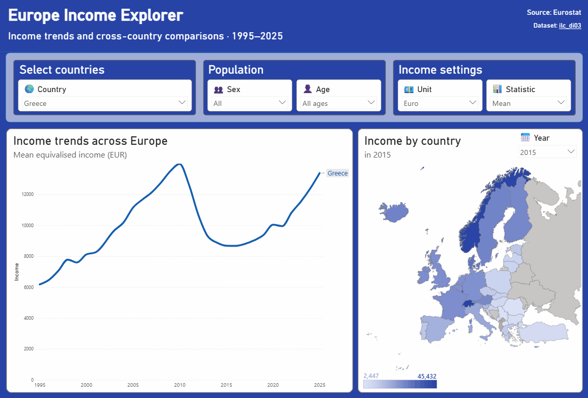
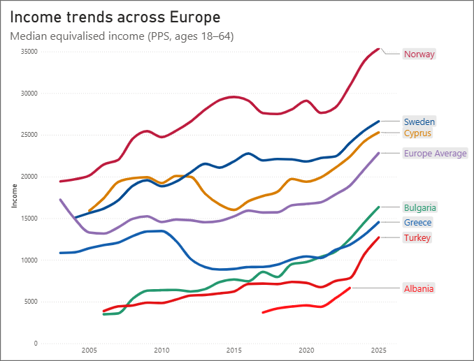
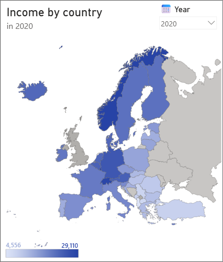
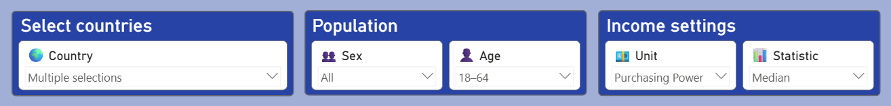

# European Income Distribution Analytics Pipeline

## Overview

An end-to-end analytics workflow for exploring **Eurostat income distribution data across European countries from 1995 to 2025**. The project brings together mean and median equivalised income data and enables analysis of **income trends across countries and demographic groups**, including age and sex, as well as different income measures, including euros and purchasing power standards (PPS).

The data is cleaned, transformed and modeled in a **dimensional star schema**, providing the foundation for a **Power BI report** with interactive country comparisons, income trends over time, and a European choropleth map. The project also includes **PostgreSQL-based SQL validation and analysis** of the resulting data model.

**Workflow:** `Eurostat → Python/Pandas → Star Schema → PostgreSQL → SQL Analysis → Power BI`

---

## Table of Contents

- [Dashboard Preview](#dashboard-preview)
- [Analytical Questions](#analytical-questions)
- [Dataset](#dataset)
- [Dashboard](#dashboard-overview)
  - [Income Trends Across Europe](#income-trends-across-europe)
  - [Income by Country](#income-by-country)
  - [Interactive Filters and Settings](#interactive-filters-and-settings)
- [Project Workflow](#project-workflow)
- [Data Warehouse Schema](#data-warehouse-schema)
- [Repository Structure](#repository-structure)
- [Technologies](#technologies)
- [Author](#author)

---

## Dashboard Preview



*Interactive dashboard developed in Power BI for exploring European income distribution by country, year, age group, sex, unit, and statistic type.*

---

## Analytical Questions

The project was designed to explore questions such as:

- How has income changed across European countries over time?
- How do mean and median income differ across countries?
- How do income levels vary by age group and sex?
- Which countries show the largest changes in income over time?
- How do income trends differ between demographic groups?

---
## Dataset

**Source:** [Eurostat](https://ec.europa.eu/eurostat/)

**Dataset:** `ilc_di03` – *Mean and median income by age and sex (source: SILC)*

**Data coverage:** 1995 – 2025

The dataset is based on EU Statistics on Income and Living Conditions (EU-SILC) and provides **annual** statistics on mean and median equivalised income by country, age group, and sex, covering 1995–2025 where data are available. Values are reported in euros (EUR), purchasing power standards (PPS), or national currency (NAC), enabling comparisons across populations and countries.

---

## Dashboard Overview

An interactive **Power BI dashboard** for exploring income trends and comparing income levels across European countries from **1995 to 2025**, using transformed data from **Eurostat**.

The dashboard combines an interactive **line chart** and a country-level **choropleth map** to explore how income levels vary across Europe and evolve over time. Users can customize their analysis through filters for **countries, demographic groups, measurement units, statistical measures, and years**.

The star schema is extracted from a PostgreSQL database, allowing automatic refreshing each time the underlying tables are updated.


<a id="income-trends-across-europe"></a>
### 1. Income Trends Across Europe — Multi-line Chart 📈

A multi-series line chart illustrating how **income levels change over time** across selected countries and European aggregates.


<table>
  <thead>
    <tr>
      <th width="25%">Feature</th>
      <th width="45%">Description</th>
      <th width="30%" align="center">Preview</th>
    </tr>
  </thead>
  <tbody>
    <tr>
      <td><strong>Country Comparisons</strong></td>
      <td>Analyze multiple countries and track trends from <strong>1995–2025</strong>.</td>
      <td rowspan="2" align="center" valign="middle">
        
      </td>
    </tr>
    <tr>
      <td><strong>European Benchmarks</strong></td>
      <td>Compare results with the <strong>Euro area, EU, 10th/25th/50th/75th/90th percentiles, and European average</strong>.</td>
    </tr>
  </tbody>
</table>


**Multi-line chart implementation:**
- **Country colors:** Derived from national flags using the [REST Countries API](https://restcountries.com/), with local caching.
- **Readability:** Light colors are rejected, and similar colors are avoided where possible.
- **Aggregate colors:** Euro area and EU use predefined teal and blue; percentiles and the mean use purple shades.
- **API configuration:** `REST_COUNTRIES_API_KEY` is required for automatic flag-based color assignment.

<a id="income-by-country"></a>
### 2. Income by Country — Choropleth Map 🗺️

An interactive **European choropleth map** displaying income values by country for the selected year.


<table>
  <thead>
    <tr>
      <th width="25%">Feature</th>
      <th width="45%">Description</th>
      <th width="30%" align="center">Preview</th>
    </tr>
  </thead>
  <tbody>
    <tr>
      <td><strong>Geographical Distribution</strong></td>
      <td>Examine income distribution across European countries and identify differences using a graduated color scale.</td>
      <td rowspan="3" align="center" valign="middle">
        
      </td>
    </tr>
    <tr>
      <td><strong>Temporal Trends</strong></td>
      <td>Select a year to explore changing income patterns.</td>
    </tr>
    <tr>
      <td><strong>Country-Level Details</strong></td>
      <td>Hover over a country to see its income value, <strong>currency or unit (EUR, PPS, or NAC)</strong>, selected <strong>sex and age group</strong>, and Eurostat observation <strong>flags</strong> for the selected year: <strong>(b)</strong> break in time series, <strong>(e)</strong> estimated, and <strong>(p)</strong> provisional.</td>
    </tr>
  </tbody>
</table>


**Map implementation:**
- The map uses the **Shape Map visual in Power BI**, with country boundaries defined by a custom **GeoJSON** file.
- **Geographic file:** [`dashboard/map_utils/europe.geo.json`](dashboard/map_utils/europe.geo.json).


<a id="interactive-filters-and-settings"></a>
### Interactive Filters and Settings 🎚️

The dashboard provides interactive filters that allow users to tailor their analysis to specific countries, demographic groups, and income measures.



| Filter | Available selections | Description |
|---|---|---|
| **Country** | European countries, Euro area and European Union aggregates, European income percentiles (10th, 25th, 50th, 75th, and 90th) | Select one or multiple countries or European aggregates to compare income trends in the line chart. |
| **Sex** | All, Male, Female | Filter income statistics by sex. |
| **Age** | All ages; age ranges (e.g., 25–49); open-ended groups (e.g., 18+); and under-age categories (e.g., under 65). | Select the population age group used to calculate the income statistics. |
| **Unit** | Euro (EUR), Purchasing Power (PPS), National Currency (NAC) | Choose the unit in which income values are expressed. |
| **Statistic** | Mean, Median | Choose the statistical measure used to represent income. **Μean** represents the arithmetic average, while **Μedian** represents the middle value of the income distribution. |
| **Year** | Available years from 1995 to 2025, subject to data availability. | Select the year displayed on the choropleth map. **This filter only affects the map.** |

---

## Project Workflow

<div align="center">
<pre>
Eurostat
│
▼
Extract
│
▼
Transform &amp; Clean (Python + Pandas)
│
▼
Star Schema
│
▼
PostgreSQL Data Warehouse
│
▼
SQL Validation &amp; EDA
│
▼
Power BI Dashboard
</pre>
</div>

---

## Data Warehouse Schema

The warehouse follows a star schema, with `fact_income` storing the income measures and foreign keys linking to dimension tables for country, age, sex, statistical information, and unit. This structure separates measurable income data from descriptive attributes and supports flexible SQL analysis and Power BI reporting.

<div align="center">
<pre>
dim_country
│
country_id
│
dim_age ─── age_id ─── fact_income ─── sex_id ─── dim_sex
│
statinfo_id
│
dim_statinfo
│
unit_id
│
dim_unit
</pre>
</div>

---

## Repository Structure

```text
.
├── assets/                     # Screenshots
│
├── dashboard/
│   ├── map_utils/
│   └── Eurostat_Income_Distribution_Dashboard.pbix
│
├── data/
│   ├── processed/              # Transformed dimension and fact tables
│   └── raw/                    # Raw Eurostat data
│
├── etl/
│   ├── dimensions.py
│   ├── extract.py
│   ├── load.py
│   ├── paths.py
│   ├── pipeline.py             # Runs the ETL pipeline
│   └── transform.py
│
├── sql/
│   ├── create_view.sql
│   ├── eda.sql
│   └── validation.sql
│
├── .gitignore
├── LICENSE
└── README.md
```

---

## Technologies

- Python
- Pandas
- SQLAlchemy
- PostgreSQL
- SQL
- Power BI
- Git / GitHub

---

## Author

George Aliquis

---