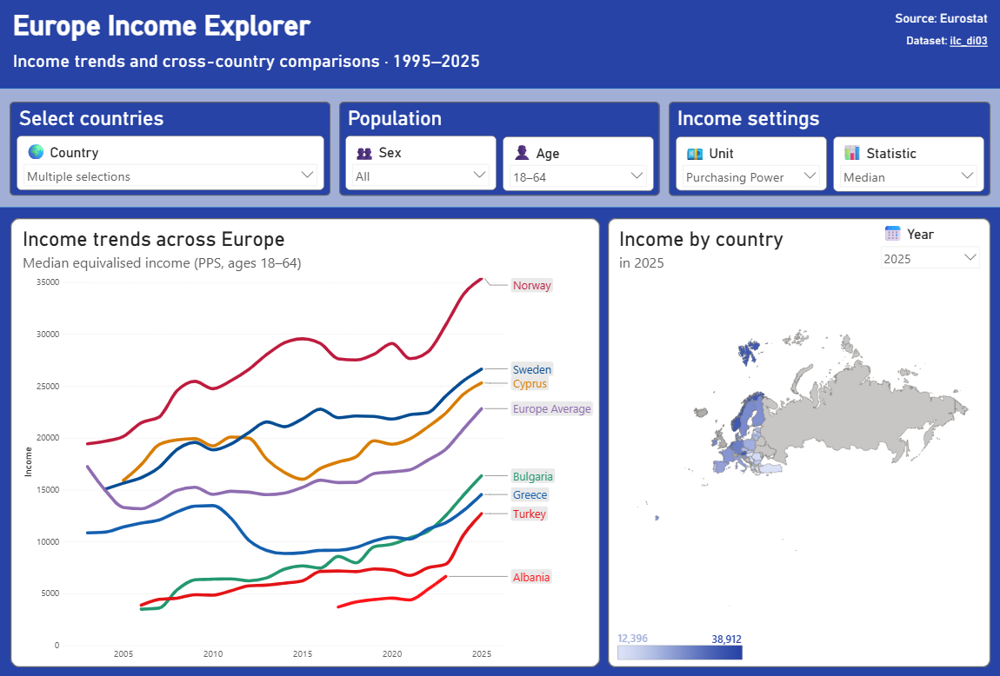

# European Income Distribution Analytics Pipeline

An end-to-end analytics workflow for exploring **Eurostat income distribution data across European countries from 1995 to 2025**. The project brings together mean and median equivalised income data and enables analysis of **income trends across countries and demographic groups**, including age and sex, as well as different income measures, including euros and purchasing power standards (PPS).

The data is cleaned, transformed and modeled in a **dimensional star schema**, providing the foundation for a **Power BI report** with interactive country comparisons, income trends over time, and a European choropleth map. The project also includes **PostgreSQL-based SQL validation and analysis** of the resulting data model.

**Workflow:** `Eurostat → Python/Pandas → Star Schema → PostgreSQL → SQL Analysis → Power BI`

---

## Table of Contents

- [Dashboard Preview](#dashboard-preview)
- [Analytical Questions](#analytical-questions)
- [Dataset](#dataset)
- [Dashboard](#dashboard)
- [Project Workflow](#project-workflow)
- [Data Warehouse Schema](#data-warehouse-schema)
- [Repository Structure](#repository-structure)
- [Technologies](#technologies)
- [Author](#author)

---

## Dashboard Preview



*Interactive dashboard developed in Power BI for exploring European income distribution by country, year, age group, sex, unit, and statistic type.*

---

## Analytical Questions

The project was designed to explore questions such as:

- How has income changed across European countries over time?
- How do mean and median income differ across countries?
- How do income levels vary by age group and sex?
- Which countries show the largest changes in income over time?
- How do income trends differ between demographic groups?

---
## Dataset

**Source:** [Eurostat](https://ec.europa.eu/eurostat/)

**Dataset:** `ilc_di03` – *Mean and median income by age and sex (source: SILC)*

**Data coverage:** 1995 – 2025

The dataset is part of the **EU Statistics on Income and Living Conditions (EU-SILC)** and provides comparable statistics on income across European countries. It contains **mean and median equivalised disposable income**, broken down by **country, year, age group, and sex**, with income reported using different units of measure, including **euro and purchasing power standard (PPS)**.

EU-SILC is Eurostat's reference data source for monitoring income distribution, poverty, social exclusion, and living conditions across Europe. National indicators are also used to calculate European aggregates, where sufficient population coverage is available.

For this project, the `ilc_di03` dataset is extracted from Eurostat, transformed with Python and Pandas, and organized into a dimensional model before being loaded into PostgreSQL for validation and analysis. The resulting model is used as the data source for the Power BI dashboard.

---

## Dashboard

An interactive Power BI dashboard for exploring income trends and comparing income levels across European countries from **1995 to 2025**, using transformed data from **Eurostat**.

The dashboard combines an interactive line chart and a country-level choropleth map to help users explore how income levels vary across Europe and evolve over time. Users can customize the analysis by selecting countries, demographic groups, measurement units, statistical measures, and years.

### Dashboard Visualizations

#### 1. Income Trends Across Europe

A multi-series line chart showing how income levels change over time for selected countries and European aggregates.

**Key capabilities:**
- Compare one or multiple countries over time.
- Track historical income trajectories from 1995 to 2025.
- Compare country-level results with European aggregates, including the 10th, 25th, 50th, 75th, and 90th income percentiles and the arithmetic mean.
- Explore how income trends differ across countries and demographic groups.
- View income values according to the selected statistical measure and measurement unit.

The chart updates dynamically according to the selected countries, sex, age group, unit, and statistic.

#### 2. Income by Country

An interactive European choropleth map displaying income values by country for the selected year.

**Key capabilities:**
- Explore the geographical distribution of income across European countries.
- Compare country-level income values using a graduated color scale.
- Select a year to examine changes in geographical income patterns over time.
- Interpret the map using a continuous legend indicating the minimum and maximum income values in the current selection.

**Map implementation:**

The map is built using the **Shape Map visual in Power BI**, with country boundaries defined by a custom GeoJSON file. The geographic file is located at:

[`dashboard/map_utils/europe.geo.json`](dashboard/map_utils/europe.geo.json)

### Interactive Filters and Settings

| Filter | Available selections | Description |
|---|---|---|
| **Country** | Albania, Austria, Belgium, Bulgaria, Croatia, Cyprus, Czechia, Denmark, Estonia, Finland, France, Germany, Greece, Hungary, Iceland, Ireland, Italy, Kosovo, Latvia, Lithuania, Luxembourg, Malta, Montenegro, Netherlands, North Macedonia, Norway, Poland, Portugal, Romania, Serbia, Slovakia, Slovenia, Spain, Sweden, Switzerland, Turkey, United Kingdom; Euro area and European Union aggregates; European income percentiles (10th, 25th, 50th, 75th, 90th) and the European average. | Select one or multiple countries and European aggregates to compare income trends in the line chart. |
| **Sex** | All, Male, Female | Filter income statistics by sex. **All** includes the combined population where available. |
| **Age** | **TOTAL:** All ages. **RANGE:** 6–11, 6–10, 11–15, 12–17, 16–24, 16–64, 18–24, 18–64, 25–49, 25–54, 50–64, 55–64, 65–74. **OPEN_ENDED:** 16+, 18+, 60+, 65+, 75+. **UPPER_BOUNDED:** Under 6, Under 16, Under 18, Under 60, Under 65, Under 75. | Select the population age group used to calculate the income statistics. |
| **Unit** | Euro (EUR), Purchasing Power Standard (PPS), National Currency (NAC) | Choose the unit in which income values are expressed. PPS supports comparisons that account for differences in purchasing power between countries. |
| **Statistic** | Mean, Median | Choose the statistical measure used to represent income. The mean represents the arithmetic average, while the median represents the middle value of the income distribution. |
| **Year** | Available years from 1995 to 2025, subject to data availability. | Select the year displayed on the choropleth map (**this filter only affects the map**). |

The available results depend on the selected filters and the coverage of the underlying dataset. Some combinations of countries, demographic groups, units, statistics, and years may not have data available.

## Project Workflow

<div align="center">
<pre>
Eurostat
│
▼
Extract
│
▼
Transform &amp; Clean (Python + Pandas)
│
▼
Star Schema
│
▼
PostgreSQL Data Warehouse
│
▼
SQL Validation &amp; EDA
│
▼
Power BI Dashboard
</pre>
</div>

---

## Data Warehouse Schema

The warehouse follows a star schema, with `fact_income` storing the income measures and foreign keys linking to dimension tables for country, age, sex, statistical information, and unit. This structure separates measurable income data from descriptive attributes and supports flexible SQL analysis and Power BI reporting.

<div align="center">
<pre>
dim_country
│
country_id
│
dim_age ─── age_id ─── fact_income ─── sex_id ─── dim_sex
│
statinfo_id
│
dim_statinfo
│
unit_id
│
dim_unit
</pre>
</div>

---

## Repository Structure

```text
.
├── assets/                     # Screenshots
│
├── dashboard/
│   └── Eurostat_Income_Distribution_Dashboard.pbix
│
├── data/
│   ├── processed/              # Transformed dimension and fact tables
│   └── raw/                    # Raw Eurostat data
│
├── etl/
│   ├── dimensions.py
│   ├── extract.py
│   ├── load.py
│   ├── paths.py
│   ├── pipeline.py             # Runs the ETL pipeline
│   └── transform.py
│
├── sql/
│   ├── create_view.sql
│   ├── eda.sql
│   └── validation.sql
│
├── .gitignore
├── LICENSE
└── README.md
```

---

## Technologies

- Python
- Pandas
- SQLAlchemy
- PostgreSQL
- SQL
- Power BI
- Git / GitHub

---

## Author

George Aliquis

---